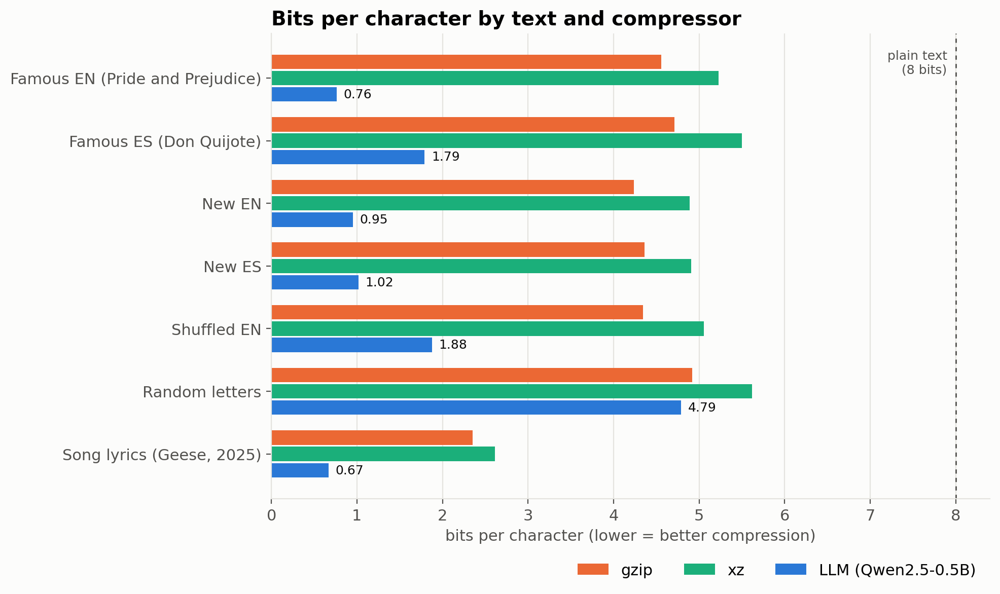

# Compressing text with an LLM

A hands-on companion to 3Blue1Brown's *Compression is Intelligence* series. The notebook uses a small open model (Qwen2.5-0.5B) and arithmetic coding to compress real text, then decompresses it back byte for byte.

## What it does

1. **Compress a real file.** A new 867-byte paragraph goes down to 105 bytes (gzip: 459), and decompresses exactly.
2. **Compare texts.** LLM vs gzip vs xz on famous text, new text, Spanish, shuffled words and random letters.
3. **Model size.** GPT-2, Qwen2.5-0.5B and Qwen2.5-1.5B on the same English and Spanish paragraph.
4. **Count the model's size.** When does a ~1 GB model pay for itself compared with gzip and xz?

## Run it

Open the notebook in Colab, set *Runtime → Change runtime type → T4 GPU*, and run all cells (around 5 to 10 minutes). It also runs on CPU, more slowly.

To try your own text, paste it into `YOUR_TEXT` in the **Texts** cell and set `YOUR_LABEL` to the name you want in the charts.

## Notes

- Encoder and decoder must see identical probabilities, so compress and decompress on the same runtime.
- gzip and xz are measured as raw streams (no headers) to be fair on short texts.
- The cover-image cells hide the words of the text, which is useful for material you should not republish, such as song lyrics.

## References

- 3Blue1Brown. (2026). *Compression is intelligence*, Parts 1 and 2 [Video series]. YouTube.
- Shannon, C. E. (1951). Prediction and entropy of printed English. *Bell System Technical Journal, 30*(1), 50–64.
- Witten, I. H., Neal, R. M., & Cleary, J. G. (1987). Arithmetic coding for data compression. *Communications of the ACM, 30*(6), 520–540.
- Delétang, G., et al. (2023). *Language modeling is compression*. arXiv. https://doi.org/10.48550/arXiv.2309.10668
- Qwen Team. (2024). *Qwen2.5 technical report*. arXiv. https://doi.org/10.48550/arXiv.2412.15115
